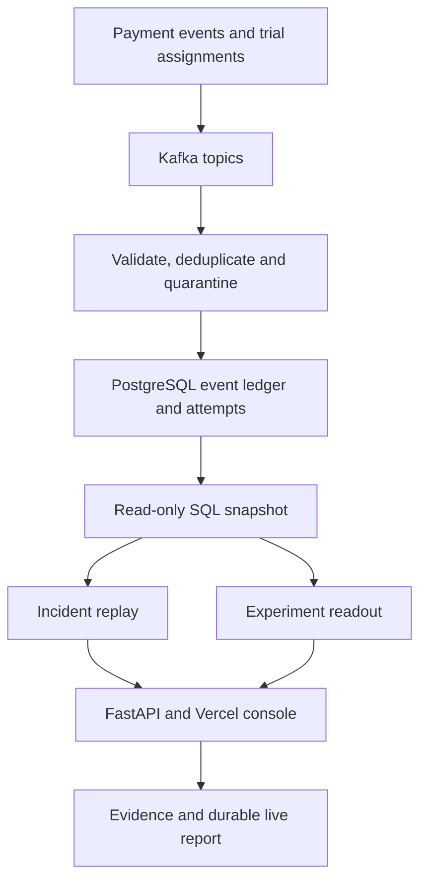

# PayLens

PayLens investigates payment conversion drops and checks whether a checkout experiment has enough evidence for rollout review. It groups payment events into attempts, compares outcomes at the same observation age, and records the approved SQL and parameters behind each result.

## Run the application

```bash
python -m pip install -r requirements.txt
python cli.py api
```

Open [localhost:8000](http://127.0.0.1:8000). The public scenarios and experiment are computed by FastAPI from deterministic event fixtures. The Open Data view uses attributed public aggregates. The console and API deploy together on Vercel using the FastAPI entry point in `pyproject.toml`.

| View | What it answers |
|---|---|
| Incident replay | Did a route get worse, did the route mix move, or did outcomes arrive after the SLA? Change the replay clock and outcome SLA to compare. |
| Experiment readout | Did a checkout change improve conversion among all assigned users? Check assignment balance, the fixed readout date, the confidence interval and payment-harm guardrails. |
| Open data | What can public shopping sessions, headline experiments and real Pix infrastructure statistics actually measure? |
| Evidence log | Which source, cutoff, metric version, SQL and parameters produced a result? Export the result and evidence as JSON. |

## Pipeline



The worker writes events, attempt projections and rejected-message coordinates before committing Kafka offsets. Redelivery is safe. Partition by attempt ID for payments and pseudonymous customer ID for assignments. A transaction-level lock protects projections when workers overlap. Benchmark this serialized write path before increasing traffic.

Incident replay computes **first terminal success within the SLA / mature explicit starts**. Both windows have the same duration and the same time allowed for outcomes. Younger starts, post-SLA outcomes and unresolved attempts are visible separately. A midpoint decomposition reconciles the total change into within-route, routing-mix and unmatched-route contributions. A nearby change record is timing evidence.

Experiment evaluation starts from immutable assignments. Each eligible user contributes once, including users with no observed checkout. The preregistered protocol specifies enrollment, outcome horizon, planned split, sample size and a minimum meaningful lift. The final readout requires trusted completeness for payment, assignment and guardrail streams. New events behind an attested checkpoint invalidate that checkpoint. The evidence includes sample-ratio mismatch, a 95% risk-difference interval and multiplicity-adjusted guardrail intervals. A candidate requires human review.

The existing question-driven LangGraph flow is available at the authenticated legacy API. Its settled-attempt experiment output is exploratory. The public calculations and the live V2 endpoints run with typed scopes and need no model key.

## Kafka and PostgreSQL

The Compose stack uses a single Kafka broker and a local PostgreSQL instance. Its API binds to localhost.

```bash
cp .env.example .env
docker compose up --build -d
docker compose --profile seed run --rm producer
```

Use **Connect live feed** at [localhost:8000/#live](http://127.0.0.1:8000/#live) with the `PAYLENS_API_TOKEN` from your local `.env`. Live results persist in Postgres. Without an attested payment watermark the API identifies the horizon as the latest observed event.

For an existing Postgres volume, create the reader login before starting the app. Run the migration once with an owner account and use separate credentials for ingest, API audit writes and read-only analytics. `sql/init.sql` grants the V2 analysis tables to a no-login role that can be assigned to the analytics login. Use `sslmode=verify-full` for an external Postgres connection and a TLS Kafka listener for the producer/consumer.

```bash
python -m paylens.replay.ops migrate
python -m paylens.replay.ops register experiment-protocol.json
python -m paylens.replay.ops attest payments 2026-10-01T01:00:00Z
```

Register a protocol before its enrollment start. See the [protocol schema](paylens/replay/experiment.py). Advance each completeness checkpoint only after reconciling the corresponding upstream partitions and late events. The experiment requires checkpoints for `payments`, `assignments` and `guardrails`. The Kafka worker runs continuously on separate infrastructure. Vercel runs the console and query API.

| API | Access |
|---|---|
| `GET /api/v2/replay`, `GET /api/v2/experiments/checkout`, `GET /api/v2/benchmarks` | Public, isolated data |
| `POST /api/v2/live/replay`, `POST /api/v2/live/experiments/{id}` | Bearer token, PostgreSQL and read-only analytics connection |
| `GET /api/v2/live/reports/{run_id}` | Bearer token, persisted live report |

The protected legacy CSV endpoint and CLI keep each upload in an isolated temporary store. Legacy CSVs contain stage summaries and cannot establish precise event-arrival or experimental coverage. The API caps CSV files at 8 MiB.

## Public data and research

- **UCI Online Shoppers Purchasing Intention** contains 12,330 shopping sessions and a purchase indicator. PayLens reads visitor-group counts and conversion. [UCI dataset and CC BY 4.0 terms](https://archive.ics.uci.edu/dataset/468/online+shoppers+purchasing+intention+dataset)
- **Upworthy Research Archive** contains randomized headline experiments. PayLens verifies the source checksum, excludes tests in the authors’ documented risk interval, and uses a deterministic sample of eligible aggregate arms. [Archive and CC BY 4.0 terms](https://upworthy.natematias.com/about-the-archive.html) · [2024 author correction](https://doi.org/10.1038/s41597-024-03600-w)
- **Banco Central do Brasil SPI** publishes Pix settlement-network availability and historical outage observations. PayLens preserves those measures at the source grain. The normalized Pix subset retains ODbL 1.0 attribution and license. [Banco Central do Brasil](https://dadosabertos.bcb.gov.br/dataset/estatisticas-do-spi-sistema-de-pagamentos-instantaneos) · [ODbL 1.0](https://opendatacommons.org/licenses/odbl/1-0/)
- The original Olist adapter remains useful for an isolated **order delivery proxy** replay. Order delivery and cancellation describe fulfillment, while the source lacks payment gateway attempt outcomes. [Olist source and CC BY-NC-SA 4.0 terms](https://www.kaggle.com/datasets/olistbr/brazilian-ecommerce)

[The engineering review](docs/REVIEW.md) connects the design to finance text-to-SQL research, sample-ratio mismatch and fixed versus sequential experiment inference. [The snapshot builder](scripts/build_benchmarks.py) records source file checksums and rebuilds the normalized public data.

## Verification

```bash
python -m pip install -r requirements-dev.txt
ruff check paylens tests scripts cli.py
python -m pytest -ra
node --check public/assets/app.js
```

Use `scripts/smoke_stream.py` against disposable Kafka and PostgreSQL instances with the environment variables in `.env.example`. It exercises Kafka redelivery, malformed records, PostgreSQL projections, restricted reads, API authentication and evidence persistence.

A bank deployment still needs its own event contracts and reconciliation, identity and tenant controls, monitoring and load testing. See the [service boundary](SERVICES.md).
