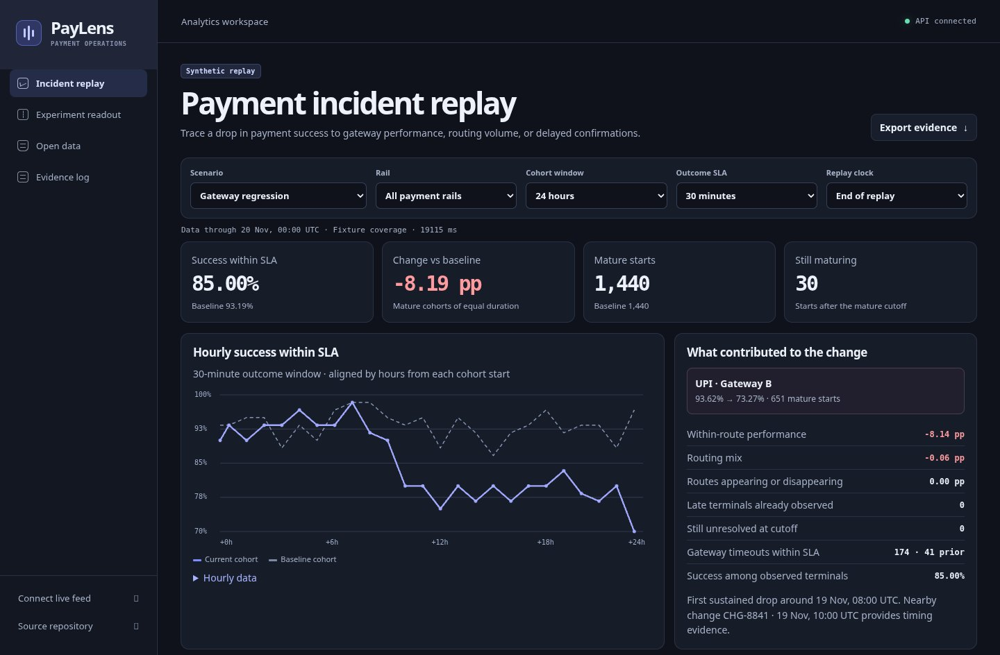
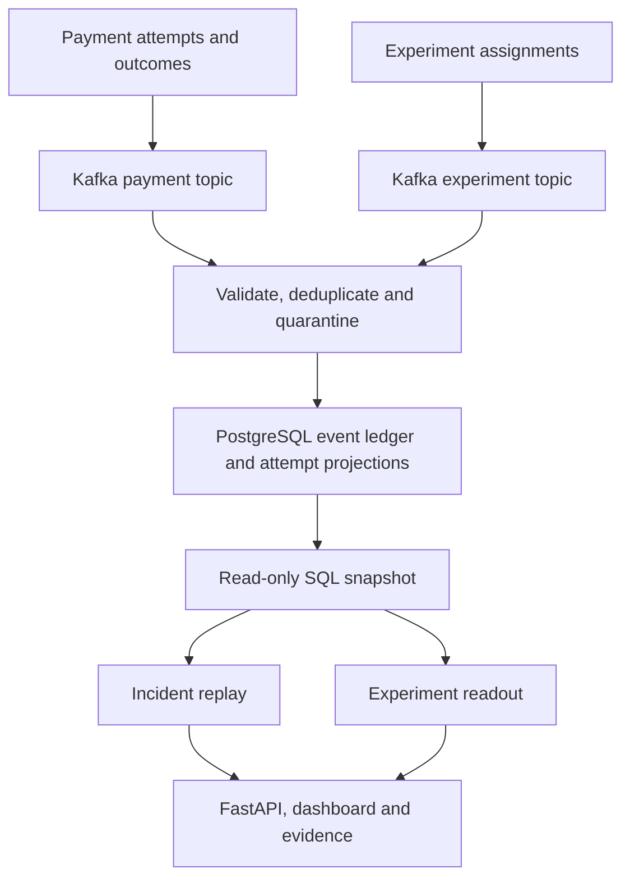

# PayLens

**Payment incident replay and checkout experimentation**

PayLens helps payments teams explain why checkout success dropped and decide whether a checkout change is ready for rollout review. It can distinguish a gateway regression, a shift in routing volume, and late confirmations. Every result includes the metric version, time window, SQL template, and parameters used to calculate it.

[Open the live demo](https://pay-lens-eight.vercel.app/) · [How the pipeline works](#how-the-pipeline-works) · [Data sources](#data-sources) · [Run locally](#run-locally)



## Explore the demo

| View | What you can investigate |
| --- | --- |
| **Incident replay** | Change the scenario, payment rail, cutoff, or outcome SLA. Inspect the funnel and break down the overall change by route performance and traffic mix. |
| **Experiment readout** | See how checkout conversion changed among assigned users. Switch the observation cutoff to see which checks block an early decision. |
| **Open data** | Explore published shopping conversion, randomized headline tests, and Pix network availability at their original reporting levels. |
| **Evidence log** | Inspect the approved queries, their parameters, source coverage, and metric versions. Download the result and supporting evidence as JSON. |

## How the pipeline works



1. **Collect events.** A customer opens checkout and selects UPI. The application emits a start, method selection, initiation, and a terminal success or failure, with a stable event ID and a shared attempt ID. The checkout experiment publishes its user assignments independently.
2. **Build one record per attempt.** The Kafka worker validates the events, skips redelivered event IDs, and quarantines malformed messages. It writes the event ledger and attempt state to PostgreSQL before committing Kafka offsets. Event timestamps let it handle confirmations that arrive out of order.
3. **Compare cohorts at the same age.** The incident endpoint queries two equal-duration groups of mature starts through an approved SQL template. A start is mature once its outcome SLA has elapsed. PayLens divides the first terminal successes within that SLA by all mature starts and separately shows late and unresolved outcomes.
4. **Explain the change.** The report separates changes within each payment route from changes in how much traffic the route received. It breaks out routes present in just one cohort and shows the funnel and hourly trend. Nearby deployment records are timing evidence.
5. **Evaluate the checkout change.** The experiment endpoint counts each eligible assigned user once, including users who never started a payment. The preregistered protocol defines the split, enrollment period, outcome window, and minimum meaningful lift. The final readout checks assignment balance, attested source coverage, the 95% confidence interval, and uncertainty bounds for timeouts, duplicate charges, and refunds. A candidate still requires human review.
6. **Return the evidence.** FastAPI serves the dashboard and JSON readouts. The authenticated live path persists the report and query audit in PostgreSQL.

> **Example from the synthetic replay.** In **Delayed confirmations**, the success rate among observed terminal outcomes is **93.64%**. The 30-minute success rate across mature starts is **80.14%**, and the replay records **189 late outcomes**. The outcome deadline exposes the customer experience the settled-only rate misses.

The **public Vercel app** runs the same incident and experiment calculations on deterministic payment fixtures in SQLite and serves the published benchmark aggregates. The **private live path** connects the API to PostgreSQL and receives events from a continuously running Kafka worker. The question-driven LangGraph workflow remains available through the protected legacy API. The V2 calculations need no model key.

## Data sources

The public datasets cover observed conversion, controlled experiments, and network uptime. Payment gateway incidents and checkout treatment effects in the replay use synthetic events so the underlying change is known.

| Published dataset | What PayLens uses | Scope |
| --- | --- | --- |
| **UCI Online Shoppers Purchasing Intention** | **12,330 sessions**, including **1,908 purchases**. The app shows purchase conversion by visitor group. | Observed shopping outcomes. [UCI dataset and CC BY 4.0 terms](https://archive.ics.uci.edu/dataset/468/online+shoppers+purchasing+intention+dataset) |
| **Upworthy Research Archive** | **4,873** headline experiments in the exploratory archive. The pipeline excludes **1,050** in the documented randomization-risk period and screens the remaining **3,823**. The app shows a deterministic sample of **12**. | Randomized headline impressions and clicks. [Archive and CC BY 4.0 terms](https://upworthy.natematias.com/about-the-archive.html) · [Author correction](https://doi.org/10.1038/s41597-024-03600-w) |
| **Banco Central do Brasil SPI** | Monthly Pix settlement-network availability and published interruption records. The app shows availability alongside its regulatory minimum. | Payment infrastructure uptime. [BCB dataset](https://dadosabertos.bcb.gov.br/dataset/estatisticas-do-spi-sistema-de-pagamentos-instantaneos) · [ODbL 1.0](https://opendatacommons.org/licenses/odbl/1-0/) |
| **Olist Brazilian E-commerce** | An optional legacy adapter maps order delivery and cancellation for fulfillment analysis. | Order fulfillment. [Olist source and CC BY-NC-SA 4.0 terms](https://www.kaggle.com/datasets/olistbr/brazilian-ecommerce) |

The [benchmark snapshot](paylens/replay/data/benchmarks.json) records source URLs, checksums, and licenses. The [snapshot builder](scripts/build_benchmarks.py) regenerates the public aggregates. The [engineering review](docs/REVIEW.md) explains the research choices and the differences from the original implementation.

## Run locally

### Public replay

Use Python 3.12.

```bash
python -m pip install -r requirements.txt
python cli.py api
```

Open [localhost:8000](http://127.0.0.1:8000). FastAPI serves both the console and query API. Vercel uses the FastAPI entry point defined in `pyproject.toml`.

### Kafka and PostgreSQL

Docker Compose starts a local Kafka broker, PostgreSQL, the consumer, and the API on localhost.

```bash
cp .env.example .env
docker compose up --build -d
docker compose --profile seed run --rm producer
```

Open [Connect live feed](http://127.0.0.1:8000/#live) and enter the `PAYLENS_API_TOKEN` from your local `.env`. Live reports persist in PostgreSQL. Without an attested payment checkpoint, the API uses the latest observed event as the analysis horizon.

For an existing PostgreSQL volume, create the reader login before starting the app. Run migrations with the owner account and use separate credentials for ingestion, API audit writes, and read-only analytics. The [role setup](sql/init.sql) grants access to the V2 analysis tables through a no-login role. Use `sslmode=verify-full` for external PostgreSQL connections and a TLS listener for Kafka.

```bash
python -m paylens.replay.ops migrate
python -m paylens.replay.ops register experiment-protocol.json
python -m paylens.replay.ops attest payments 2026-10-01T01:00:00Z
```

Register the [experiment protocol](paylens/replay/experiment.py) before enrollment. Advance the `payments`, `assignments`, and `guardrails` checkpoints after reconciling the corresponding upstream partitions and late events. A new event older than a checkpoint invalidates that checkpoint. The worker serializes projection writes with a transaction lock. Benchmark that path against the intended traffic volume.

### API entry points

| Endpoint | Access |
| --- | --- |
| `GET /api/v2/replay`, `GET /api/v2/experiments/checkout`, `GET /api/v2/benchmarks` | Public replay and benchmarks |
| `POST /api/v2/live/replay`, `POST /api/v2/live/experiments/{id}` | Bearer token, PostgreSQL, and read-only analytics connection |
| `GET /api/v2/live/reports/{run_id}` | Bearer token and persisted report |

The authenticated legacy CSV endpoint and CLI use isolated temporary stores. The API caps CSV files at 8 MiB. CSV stage summaries support exploratory analysis. Precise outcome timing and experiment coverage require event-level data.

## Verification

The release passed **69 Python tests** and desktop and mobile browser checks. A Kafka-to-PostgreSQL integration run verified **488 distinct events** and **200 assignments**, including duplicate delivery, malformed-message quarantine, and authenticated incident and experiment readouts. [Release CI](https://github.com/deepak2233/PayLens/actions/runs/45873663465)

```bash
python -m pip install -r requirements-dev.txt
ruff check paylens tests scripts cli.py
python -m pytest -ra
node --check public/assets/app.js
```

Use [the streaming smoke test](scripts/smoke_stream.py) against disposable Kafka and PostgreSQL services configured with `.env.example`. A bank rollout requires the bank’s event contracts, reconciliation, identity and tenant controls, production monitoring, and load testing. [Service boundaries](SERVICES.md)
